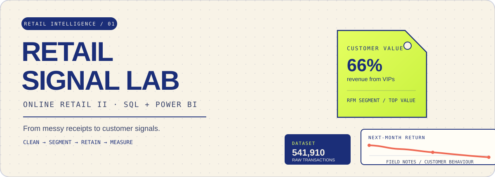
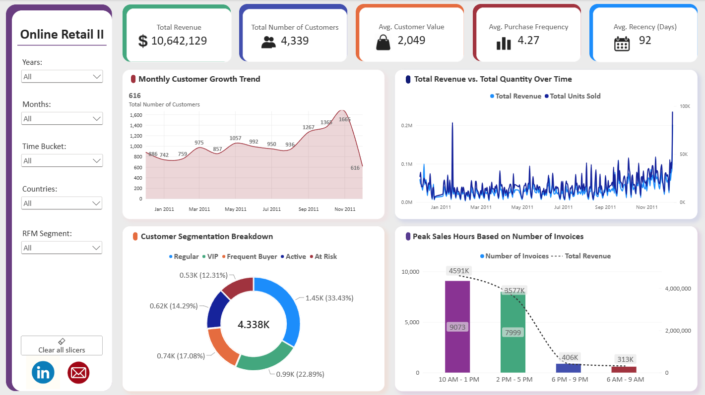
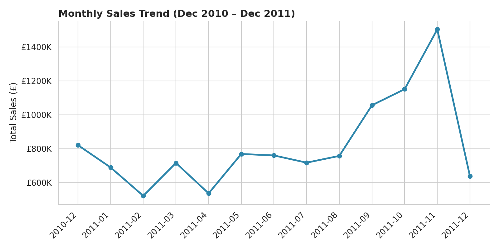
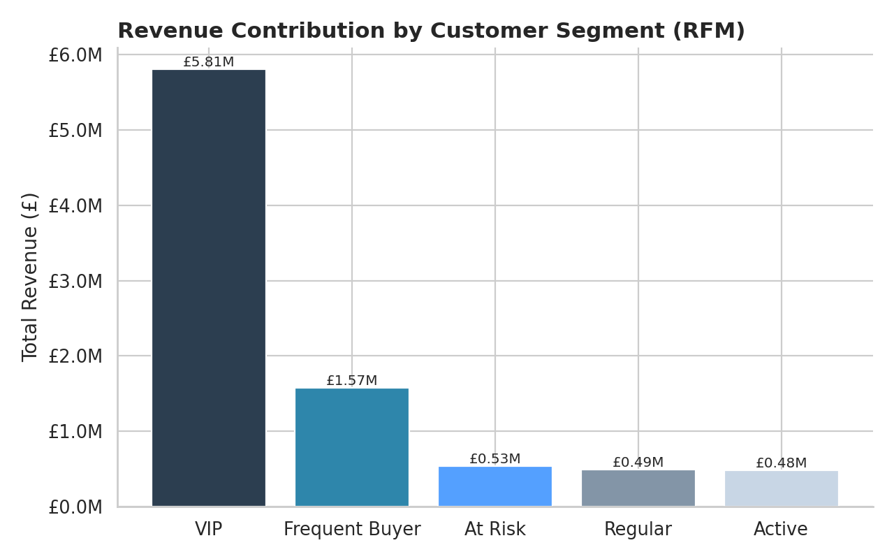
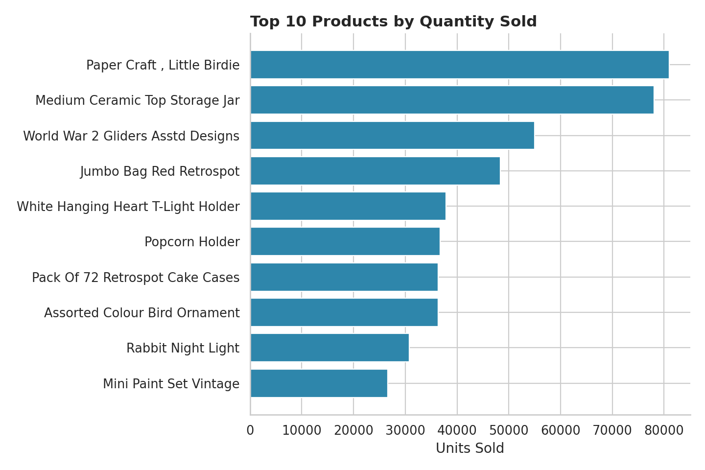
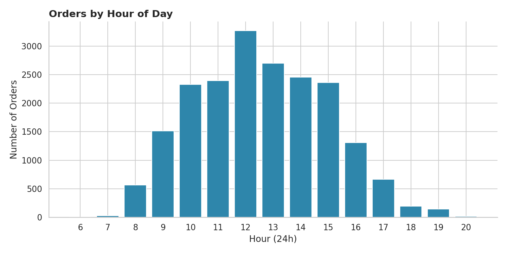
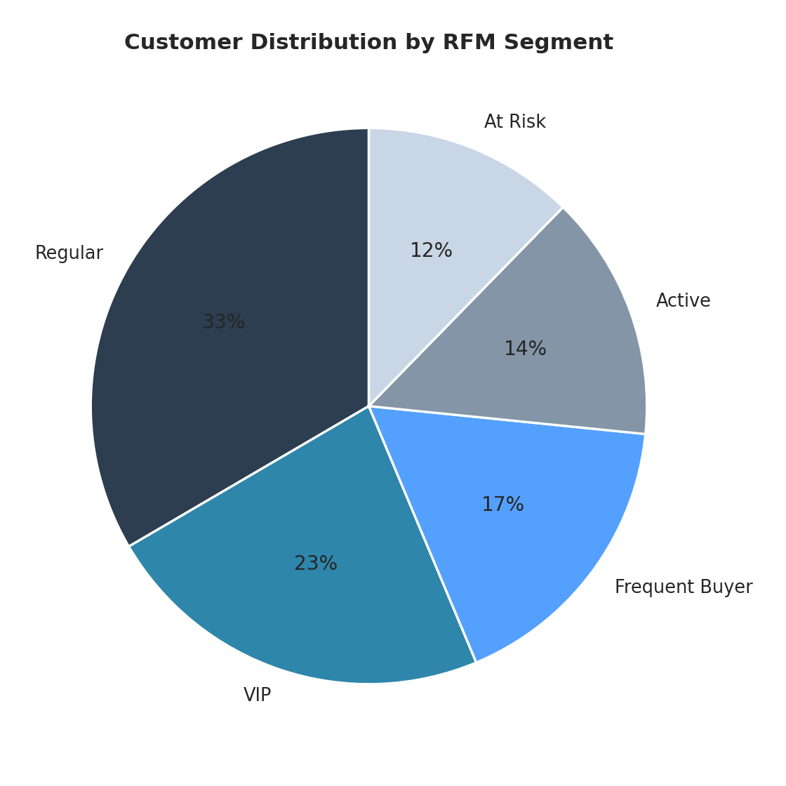

<div align="center">



<br/>


### A customer-behaviour investigation built with SQL.

[The business signals](#-the-signals-at-a-glance) · [Dashboard & charts](#-the-retail-floor) · [SQL pipeline](#-behind-the-receipt) · [Reproduce it](#-rebuild-the-analysis)

</div>

---

> **The question:** Which customers drive the business today—and what evidence can help us keep them coming back tomorrow?

This project explores the **Online Retail II** dataset from the UCI Machine Learning Repository: 541,910 UK e-commerce transaction rows from December 2010 to December 2011. I built a reproducible SQL workflow for data cleaning, feature engineering, customer segmentation and business analysis, then connected the exported results to an interactive Power BI dashboard.

**The design principle:** Python handles file input/output and chart previews. Cleaning rules, analytical features, segment definitions and business calculations live in SQL, where they can be inspected and audited.

## ◉ The signals at a glance

<table>
<tr>
<td width="50%" valign="top">

<sub>01 / CUSTOMER VALUE</sub>

# 66%

**of segment revenue comes from VIP customers.**

The VIP segment contains 993 customers—about 23% of the five segments' 4,338 identified customers—and contributes £5.81M in revenue.

</td>
<td width="50%" valign="top">

<sub>02 / RETENTION RISK</sub>

# £0.53M

**in revenue sits in the At Risk segment.**

Those 534 customers are a potential win-back audience. The segment is a starting point for prioritization, not proof that a campaign will succeed.

</td>
</tr>
<tr>
<td width="50%" valign="top">

<sub>03 / REPEAT PURCHASE</sub>

# 15–37%

**of a cohort's new customers return the following month.**

The rate varies by acquisition month. Cohort analysis makes that variation visible instead of hiding it in one overall average.

</td>
<td width="50%" valign="top">

<sub>04 / DATA QUALITY</sub>

# 524,879

**transaction rows remain in the cleaned output.**

Each cleaning decision is logged. Unusual values are flagged rather than automatically erased when they may represent genuine wholesale activity.

</td>
</tr>
</table>

<sub>These are project results, not universal benchmarks. Segment definitions, data coverage and the observation window affect interpretation.</sub>

## ◉ The retail floor

The Power BI report connects `fact_transactions.csv` and `dim_customer_rfm.csv` on `customer_id`. The interactive file is available at `powerbi/Dashboard.pbix`.

<div align="center">



<sub><b>FIG. 01</b> — The overview: sales, customer value, growth and segment mix.</sub>

</div>

### A closer look at the signals

<table>
<tr>
<td width="50%" valign="top">



**01 — Sales pulse**

How revenue changes across the observed months.

</td>
<td width="50%" valign="top">



**02 — Value concentration**

How revenue is distributed across RFM segments.

</td>
</tr>
<tr>
<td width="50%" valign="top">



**03 — Product demand**

Which products lead the sales ranking.

</td>
<td width="50%" valign="top">



**04 — Shopping rhythm**

When invoices are most frequent across time-of-day buckets.

</td>
</tr>
<tr>
<td width="50%" valign="top">



**05 — Customer mix**

How customers are distributed across the analyzed population.

</td>
<td width="50%" valign="top">

**Dashboard controls**

- Year and month
- Time-of-day bucket
- Country
- RFM segment

**Headline KPIs**

Total revenue, total customers, average customer value, average purchase frequency and average recency in days.

</td>
</tr>
</table>

## ◉ The RFM lens

I scored customers from 1 to 5 on **Recency, Frequency and Monetary value**, using quintiles, then assigned them to five business-facing segments.

| Segment | Customers | Revenue |
|:--|--:|--:|
| VIP | 993 | £5.81M |
| Frequent Buyer | 741 | £1.57M |
| At Risk | 534 | £0.53M |
| Regular | 1,450 | £0.49M |
| Active | 620 | £0.48M |

The full scoring logic lives in [`sql/03_rfm_analysis.sql`](sql/03_rfm_analysis.sql).

<details>
<summary><b>How I would translate these segments into decisions</b></summary>

- **VIP:** test retention benefits and monitor whether high-value customers stay active.
- **Frequent Buyer:** look for ways to protect purchase cadence and grow basket value.
- **At Risk:** test a win-back message, then measure reactivation rather than counting messages sent.
- **Regular / Active:** monitor changes in frequency and recency to identify movement between segments.

These are possible actions suggested by the analysis, not measured campaign outcomes.

</details>

## ◉ Behind the receipt

The pipeline moves from raw records to reusable reporting tables. The order matters: later scripts rely on the cleaned and engineered data created earlier.

<table>
<tr>
<td width="22%" align="center" valign="top">

### 01

**Clean**

</td>
<td width="78%" valign="top">

[`01_data_cleaning.sql`](sql/01_data_cleaning.sql)

Handle cancellations, invalid quantity/price values, exact duplicates, country-name standardization and data-quality flags. A `data_quality_log` records rules and affected rows.

</td>
</tr>
<tr>
<td align="center" valign="top">

### 02

**Engineer**

</td>
<td valign="top">

[`02_feature_engineering.sql`](sql/02_feature_engineering.sql)

Create analytical fields such as revenue, calendar components and time-of-day buckets.

</td>
</tr>
<tr>
<td align="center" valign="top">

### 03

**Segment**

</td>
<td valign="top">

[`03_rfm_analysis.sql`](sql/03_rfm_analysis.sql)

Calculate RFM scores and group customers into five segments.

</td>
</tr>
<tr>
<td align="center" valign="top">

### 04

**Report**

</td>
<td valign="top">

[`04_business_insights.sql`](sql/04_business_insights.sql)

Create reporting views for business questions and downstream export.

</td>
</tr>
<tr>
<td align="center" valign="top">

### 05

**Go deeper**

</td>
<td valign="top">

[`05_advanced_analysis.sql`](sql/05_advanced_analysis.sql)

Use window functions and self-joins for month-over-month growth, cohort retention, customer lifetime value (CLV) and market-basket analysis.

</td>
</tr>
</table>

### Cleaning decisions are part of the analysis

| Rule | Rows affected | Treatment |
|:--|--:|:--|
| Cancelled invoices (`Invoice` begins with `C`) | 9,288 | Moved to `cancelled_transactions` |
| Non-positive quantity or price | 3,853 | Removed |
| Exact duplicate rows | 4,842 | Removed |
| Country-name variants | 8,991 | Standardized |
| Administrative / non-product stock codes | 2,308 | Flagged and kept |
| Quantity / price outliers (IQR) | 27,111 / 37,828 | Flagged and kept |
| Missing Customer ID | 132,186 | Flagged and kept for non-customer analyses; excluded from RFM |

**Why flag outliers instead of deleting them?** A very large order may be unusual but legitimate. Treating statistical rarity as an automatic data error could erase meaningful wholesale activity.

<details>
<summary><b>Data-quality notes and interpretation boundaries</b></summary>

- The cleaned output contains 524,879 transaction rows from 541,910 raw rows.
- The stock codes listed as administrative or non-product items are flagged with `is_adjustment_code`; they are not silently removed.
- Outliers are flagged in `is_outlier_quantity` and `is_outlier_price`.
- Rows without a Customer ID remain available for country/product analysis but cannot be assigned to customer-level RFM segments.
- The exact rule, affected-row count and treatment are recorded in the `data_quality_log` table.

</details>

## ◉ SQL techniques in the wild

| Technique | Applied to |
|:--|:--|
| CTEs | Separating multi-step calculations into readable stages |
| Window functions and `LAG()` | Month-over-month comparisons |
| Self-joins | Cohort retention and products bought on the same invoice |
| Conditional logic | RFM segment labels and business rules |
| Date functions | Purchase month, tenure and time buckets |
| `NULLIF` / zero guards | Avoiding invalid division |
| Views | Reusable reporting outputs |

## ◉ Rebuild the analysis

### Requirements

- Python and packages listed in `requirements.txt`
- SQLite CLI
- The [Online Retail II dataset](https://archive.ics.uci.edu/dataset/502/online+retail+ii) from the UCI Machine Learning Repository

### Run order

```bash
pip install -r requirements.txt

# 1. Load the raw source file into SQLite
python scripts/01_load_raw_data.py --source data/raw/online_retail_II_RAW.xlsb

# 2. Run the SQL pipeline in order
sqlite3 retail.db < sql/01_data_cleaning.sql
sqlite3 retail.db < sql/02_feature_engineering.sql
sqlite3 retail.db < sql/03_rfm_analysis.sql
sqlite3 retail.db < sql/04_business_insights.sql
sqlite3 retail.db < sql/05_advanced_analysis.sql

# 3. Export reporting data and create preview charts
python scripts/02_export_for_powerbi.py
python scripts/03_generate_charts.py
```

Python is used for file loading/export and preview-chart generation; the analytical transformations and business rules are in SQL.

<details>
<summary><b>Repository map</b></summary>

```text
online-retail-data-analysis/
├── data/
│   ├── raw/                  # Original source data
│   └── processed/            # Exported tables for Power BI
├── sql/
│   ├── 01_data_cleaning.sql
│   ├── 02_feature_engineering.sql
│   ├── 03_rfm_analysis.sql
│   ├── 04_business_insights.sql
│   └── 05_advanced_analysis.sql
├── scripts/
│   ├── 01_load_raw_data.py
│   ├── 02_export_for_powerbi.py
│   └── 03_generate_charts.py
├── reports/figures/
├── powerbi/Dashboard.pbix
└── retail.db
```

</details>

## ◉ What I would improve next

- Make the reporting date configurable so recency, age and customer lifespan can be reproduced against a fixed as-of date.
- Centralize shared segment definitions to avoid maintaining the same business rules in more than one query.
- Add automated checks for orphaned keys, suspicious invoice patterns and unexpected row-count changes.
- Evaluate retention strategies with measured outcomes instead of treating segment membership as proof of future behaviour.

---

<div align="center">

**Parnaz Ali** · [GitHub profile](https://github.com/ParnazAli)

<sub>SQL-first analysis · SQLite · Power BI · UCI Online Retail II</sub>

</div>
